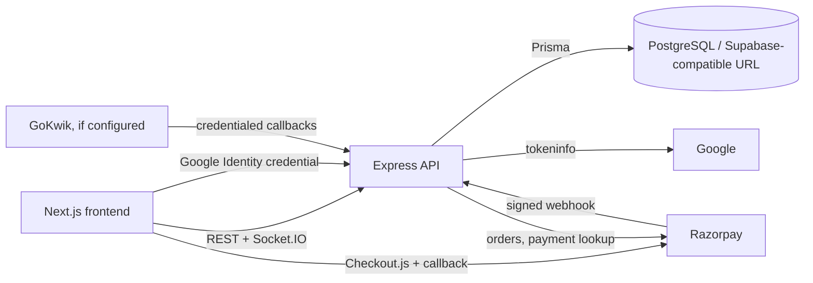

# Totemood codebase guide

## Scope and confidence

This guide is a static-code audit completed on 2026-10-25. It describes what is present in the repository; it does **not** prove deployed behavior, payment-provider configuration, database state, or test results. No environment values are recorded here.

## Overview

Totemood is a custom tote-bag store with a Next.js customer/admin frontend and an Express API backed by PostgreSQL through Prisma. It supports a browser-persisted cart, artwork/text customisation, Razorpay checkout (full prepayment or a INR 49 COD deposit), Google Identity sign-in for customer account data, and password-based administration. Socket.IO delivers catalog and order updates to connected frontend clients.

The repository is a two-package project, not a workspace/monorepo package manager setup:

```text
Totemood/
├── frontend/                 Next.js 16 application
│   ├── src/app/              App Router pages and hidden admin route
│   ├── src/components/       storefront, cart, home, layout, product, shop UI
│   ├── src/lib/              API client, Zustand stores, auth/cart/product hooks
│   ├── public/               product/gallery assets, fonts, 3D models
│   └── tests/                Playwright browser specifications
├── backend/                  Express + Prisma application
│   ├── src/index.ts          API, auth, payment, order, realtime logic
│   ├── prisma/schema.prisma  PostgreSQL data model
│   ├── prisma/migrations/    tracked Prisma migrations
│   └── tests/                manual/payment-pipeline scripts
├── render.yaml               Render backend service declaration
└── docs/CODEBASE_GUIDE.md    this guide
```

Generated/dependency directories (`node_modules`, `.next`, `dist`, `build`, coverage and test reports) are intentionally not part of the audit.

## Confirmed stack

| Area | Technology and location |
|---|---|
| Frontend | TypeScript, React 19, Next.js 16 App Router; `frontend/package.json`, `frontend/src/app` |
| Styling | Tailwind CSS 4, global CSS tokens, local Agatho/Noyh fonts; `frontend/src/app/globals.css`, `frontend/src/app/layout.tsx` |
| UI/animation | Lucide, Framer Motion, Base UI/shadcn-related dependencies, Lenis; components under `frontend/src/components` |
| 3D | Three.js, React Three Fiber/Drei assets/components; `frontend/src/components/home/*Canvas*`, `frontend/public/3Dmodel` |
| Client state | Zustand persisted to `localStorage` (cart and local auth session); `frontend/src/lib/store` |
| Client data/realtime | `fetch`, TanStack Query dependency (not confirmed in use), Socket.IO client; `frontend/src/lib/api.ts`, `useProducts.ts` |
| Backend | Node.js, TypeScript, Express 5, Socket.IO; `backend/src/index.ts` |
| Persistence | PostgreSQL + Prisma 5; `backend/prisma/schema.prisma` |
| Payments | Razorpay Orders/Checkout/API/webhooks; `backend/src/index.ts`, `frontend/src/app/checkout/page.tsx` |
| Checkout integration | GoKwik server callbacks/endpoints are implemented, but no visible storefront invocation was found; `backend/src/index.ts` |
| Customer auth | Google Identity Services, server verification at Google `tokeninfo`, custom HMAC bearer token; `frontend/src/lib/googleSignIn.ts`, `backend/src/index.ts` |
| Hosting | Render declaration for the backend only; `render.yaml` |

No Dockerfile, Compose file, CI workflow, frontend hosting configuration, or tracked `.env*` template was found.

## Architecture and principal flows



### Storefront and catalog

`frontend/src/app/layout.tsx` wraps normal pages in navbar, footer, social links, smooth scrolling and the sign-in toast. The home page composes marketing sections. `/shop` and `/shop/[id]` use `useProducts`, which fetches `GET /api/products`, normalizes fields and caches the result in `sessionStorage`; it falls back to the static product list in `frontend/src/lib/data/products.ts` if the API fails. Socket event `products_updated` causes refetching.

Product detail UI is composed by `ProductTop`, features, reviews, FAQ and related products. Ratings/reviews are presentation/fallback data rather than a database model. Product gallery values may be database URLs/data URLs or static assets.

### Cart and customisation

`useCartStore` keeps line items, quantities, custom image data URLs and custom text arrays in browser `localStorage` under `totemood_cart_v1`. It has no server cart for the visible storefront. `CartDrawer` displays and edits it. Client price totals are only display values; `buildVerifiedCheckout` re-reads products and recomputes totals server-side. Product cart state is refreshed against live product data on checkout.

Custom artwork is compressed in `frontend/src/lib/imageCompression.ts` and stored in browser state, then sent inline during checkout. The server permits JPEG/JPG/PNG/WebP base64 data URLs up to 250,000 characters and requires image/text based on product category.

### Checkout and Razorpay sequence

1. `frontend/src/app/checkout/page.tsx` validates customer fields/customisation locally, loads Razorpay Checkout.js, then calls `POST /api/checkout/razorpay-order`.
2. `buildVerifiedCheckout` validates fields, duplicate lines, max quantities, stock and customisation; it gets authoritative product prices from PostgreSQL and calculates shipping (free above INR 150, otherwise INR 15).
3. The API creates a Razorpay order in INR for either the verified full total (`prepaid`) or a INR 49 deposit (`cod`) and persists the verified checkout to `PendingCheckout` for 30 minutes.
4. Checkout.js opens with the returned order ID. On client callback, the frontend posts Razorpay IDs/signature to `POST /api/checkout/verify-razorpay`; it does not trust a redirect/query parameter.
5. The API checks the Razorpay HMAC, directly queries the Razorpay payment and checks captured status plus exact paise amount. It transactionally creates the order and decrements inventory only if stock is still sufficient. It stores `paid` for prepaid, `partial` for COD deposit, and COD balance.
6. If capture lookup is inconclusive, it creates a `pending` order and reserves stock; Razorpay webhook processing and periodic reconciliation either confirm it or delete it and restore inventory. Duplicate Razorpay IDs are unique and `createOrderFromCheckout` is designed to be idempotent.
7. `POST /api/webhooks/razorpay` validates the raw-body HMAC using `RAZORPAY_WEBHOOK_SECRET`, processes `payment.captured` and `payment.failed`, and reconciliation runs periodically.

This is a substantial implementation, not configuration-only. Its live provider configuration, webhook delivery and recovery behavior remain unverified.

### Customer account authentication

The frontend loads Google Identity Services, sends a Google credential to `POST /api/auth/google`, and stores a server-issued signed bearer token and profile in local storage. The API verifies the credential using Google tokeninfo and checks audience against `GOOGLE_CLIENT_ID`; account endpoints derive identity from the HMAC token. There is no local password registration/reset or database User model. Logged-in users can see orders matched by their email and manage `SavedAddress` rows. Logout clears local storage; server token revocation is not present.

### Admin

The frontend's obscured route is `/<ADMIN_ROUTE>` from `frontend/src/lib/admin-route.ts`; obscurity is explicitly only a UI layer. The backend is authoritative: `requireAdmin` validates a seven-day HMAC token issued after a scrypt password check against `ADMIN_PASSWORD_HASH`. Admin pages call server-protected API routes through `apiFetch`, which adds `x-admin-auth` from local storage. Admin capabilities include product CRUD (with inline base64 galleries), order listing/details/CSV export/status/display-ID update/deletion, dashboard counts and delivered-order revenue chart. Socket events update product/order dashboards.

## Database model map

Defined in `backend/prisma/schema.prisma`.

| Model | Key fields and relationships |
|---|---|
| `Product` | string CUID `id`; name, description, float price/oldPrice, cover `image`, `gallery`, category, label, inventory; has `OrderItem[]`. |
| `Order` | CUID plus unique six-digit `displayId`; customer/contact/address snapshot; totals; fulfillment `OrderStatus`; payment IDs/amounts/status; has `OrderItem[]`. |
| `OrderItem` | references `Order` (cascade deletion) and `Product` (restrict deletion); quantity, purchase price, custom image/text. |
| `PendingCheckout` | Razorpay order ID primary key, JSON checkout payload, TTL fields; index on `createdAt`. |
| `SavedAddress` | CUID, customer email and address details; index on email; no database foreign key to an account because accounts are Google-token based. |

Fulfillment enum values are `LIVE`, `MANIFESTED`, `SHIPPED`, `DD`, `DELIVER`, `RTO`, `CANCELLED`, `SHIP_LATER`. Payment status is an unconstrained string (`pending`, `paid`, `partial` are used). Razorpay order/payment IDs and display ID are unique. Order creation decrements stock in a Prisma transaction; failed/unpaid pending-order cleanup restores it.

Important schema caveat: `backend/src/index.ts` also performs runtime `CREATE/ALTER/UPDATE` compatibility work for tables/columns/gallery data. That creates schema/data mutation at server start or requests and duplicates tracked migration responsibilities.

## API map

All routes are in `backend/src/index.ts`.

| Group | Routes |
|---|---|
| Health/auth | `GET /api/health`; `POST /api/auth/google`; `GET /api/account/me` |
| Customer account (bearer token) | `GET /api/account/orders`; `GET/POST /api/account/addresses`; `PUT/DELETE /api/account/addresses/:id`; `DELETE /api/account/data` |
| Store catalog | `GET /api/products`; `GET /api/products/:id` |
| Checkout/payment | `POST /api/checkout/session` (GoKwik session helper); `POST /api/checkout/razorpay-order`; `POST /api/checkout/verify-razorpay`; `POST /api/webhooks/razorpay` |
| Admin auth/dashboard (admin token) | `POST /api/admin/login`; `GET /api/admin/stats`; `GET /api/admin/revenue-chart`; `GET /api/admin/orders` |
| Admin product/order operations (admin token for mutations/orders) | `POST/PUT/DELETE /api/products[/:id]`; `GET /api/orders`; `PUT/DELETE /api/orders/:id`; `POST /api/orders` deliberately returns 405 |
| GoKwik (shared-header authentication) | `/gokwik/v1/cart`, `/set-address`, coupon/shipping helpers, `/place-order`, `/update-order-status`, `/payment-notification`, health/check/remove-stock routes |

Public product reads intentionally fall back to hard-coded catalog data when DB access fails. Endpoint response shape is direct Prisma records or explicit JSON objects; no OpenAPI/schema validation layer exists.

## Frontend map and visual system

| Area | Important files |
|---|---|
| Site shell | `src/app/layout.tsx`, `components/layout/Navbar.tsx`, `Footer.tsx`, `MobileMenu.tsx`, `CartDrawer.tsx` |
| Home | `src/app/page.tsx`, `components/home/*` (marketing + 3D/canvas sections) |
| Shopping | `src/app/shop/page.tsx`, `src/app/shop/[id]/page.tsx`, `components/product/ProductTop.tsx`, `lib/useProducts.ts` |
| Checkout | `src/app/checkout/page.tsx`, `lib/store/useCartStore.ts`, `lib/imageCompression.ts` |
| Account | `src/app/account/AccountContent.tsx`, `lib/account.ts`, `lib/store/useAuthStore.ts`, `lib/googleSignIn.ts` |
| Admin | `src/app/db76a3f0c29053fd989eab3de4e58e5e5eb8f8e526099077/**`, `lib/admin-route.ts` |

The design uses warm off-white backgrounds, dark olive/charcoal text, muted sage accents, pale stone borders and rounded editorial cards. `globals.css` provides tokens; components also use many direct Tailwind hex classes. Responsive layouts commonly use mobile-first Tailwind breakpoints (`sm`, `md`, `lg`, `xl`). Shared shell/cart/product retrieval should be preferred over duplicating UI behavior in future work.

## Environment names and local operation

No tracked env template exists. Names referenced by code/deployment configuration are:

`DATABASE_URL`, `PORT`, `NODE_ENV`, `RENDER`, `CORS_ORIGINS`, `JSON_BODY_LIMIT`, `GOKWIK_APP_ID`, `GOKWIK_APP_SECRET`, `GOKWIK_MERCHANT_ID`, `GOKWIK_ENV`, `RAZORPAY_KEY_ID`, `RAZORPAY_KEY_SECRET`, `RAZORPAY_WEBHOOK_SECRET`, `GOOGLE_CLIENT_ID`, `NEXT_PUBLIC_GOOGLE_CLIENT_ID`, `SESSION_SECRET`, `ADMIN_PASSWORD_HASH`, `ADMIN_LOGIN_RATE_MAX`, `RECONCILE_INTERVAL_MS`, `RECONCILE_STALE_MS`, `NEXT_PUBLIC_API_URL`, `NEXT_PUBLIC_SITE_URL`, `PLAYWRIGHT_BASE_URL`, and `PLAYWRIGHT_API_URL`.

Commands evidenced by manifests (not executed in this audit):

```bash
# frontend, from frontend/
npm run dev
npm run build
npm run start
npm run lint

# backend, from backend/
npm run dev
npm run start
npm run seed    # MUTATES product data; do not run casually
```

Backend defaults to port 4000 in code; the frontend API fallback is `http://localhost:4010`, so local configuration must align them. Render runs the backend from `backend/`, installs dependencies, generates Prisma client, and starts `src/index.ts`; its declared service port is 4000.

## Tests and quality

Frontend Playwright specifications cover home, navigation, shop/product, cart, checkout UI, auth UI, account/privacy/contact, admin UI, responsiveness, accessibility and basic performance. The Playwright default base URL is an external deployed URL, not a local server. They were not run: doing so would contact that deployment and generate report artifacts.

`backend/tests/pipeline-failure.test.js` and `reconcile.test.js` are integration-style scripts that read backend environment values, contact Razorpay/backend, create/delete database records and manipulate inventory. They are not wired to `npm test` (`backend`'s test script intentionally exits 1) and were not run. `seed.ts`, `test-order.ts`, and `update_db.js` are mutation-capable utilities and were not run.

No explicit type-check script was found. A frontend ESLint script exists; no build/lint/typecheck was executed because builds/tests may write artifacts and the audit scope is read-only.

## Static security and integrity review

### Confirmed findings

| Severity | Finding | Evidence and recommended remediation |
|---|---|---|
| High | Production runtime schema/data mutation | `ensureOrderPaymentColumns`, `ensurePendingCheckoutTable`, `ensureCatalogCustomizationColumns`, and `ensureSavedAddressTable` in `backend/src/index.ts` execute DDL and catalogue updates during normal operation. Move all changes to reviewed Prisma migrations/deployment migration steps; remove request/startup mutation paths after migration. |
| Medium | Admin and customer bearer tokens are persisted in `localStorage` | `frontend/src/lib/account.ts`, `frontend/src/lib/api.ts`, admin layout. Any successful same-origin XSS can exfiltrate them; neither has server-side revocation. Prefer short-lived, HttpOnly/Secure/SameSite cookies or a refresh/revocation design; maintain strong CSP and XSS review. |
| Medium | Admin product fields lack robust server-side validation | Product create/update in `backend/src/index.ts` forwards name/description/price/inventory with normalization only for category/label. Invalid numeric values, overlong strings or oversized gallery payloads can reach the DB. Use a server-side schema (e.g. Zod), finite numeric/range checks, field lengths and aggregate upload limits. |
| Medium | Orders can be deleted without automatic inventory restoration | `DELETE /api/orders/:id` deletes items/order; only payment-failure cleanup uses `deleteOrderAndRestoreInventory`. An admin deletion can leave stock permanently lower. Define order cancellation/deletion policy and make stock restoration transactional where appropriate. |
| Low | GoKwik request bodies and payment-related payload fragments are logged | Global GoKwik logger and handlers log JSON bodies in `backend/src/index.ts`. They may include personal/order data. Use structured, redacted logs and minimize retention. |
| Low | Sensitive checkout data/artwork is persisted as JSON/base64 in PostgreSQL | `PendingCheckout.data` and `OrderItem.customImageUrl` contain customer/order data and inline artwork. Establish retention/deletion/encryption-at-rest controls; consider object storage with scoped references. |

### Risks requiring runtime/configuration verification

| Severity | Risk | Why it is not confirmed statically |
|---|---|---|
| High | GoKwik provider callbacks may be payment-integrity sensitive | Credentials are compared as static headers and `place-order` marks verified cart orders paid/partial based on GoKwik input. Whether upstream authentication/signatures, networking and credentials are adequately protected requires provider/configuration review. |
| Medium | Rate limiting is per-process in-memory | `rateLimit` does not share state across instances or restarts; effectiveness under Render scaling/proxy conditions needs deployment review. |
| Medium | Webhook signature malformed-length handling | `timingSafeEqual` is called without checking buffer lengths; malformed signatures may produce an exception/500 rather than a clean rejection. Exercise with non-production requests and add a length check. |
| Medium | No CSRF-specific design is visible | Current auth is Authorization/header tokens rather than cookies, reducing classic cookie-CSRF exposure. If migrating to cookies, add CSRF defenses. CORS allowlist correctness still needs deployment verification. |
| Informational | CSP includes `'unsafe-inline'` and `'unsafe-eval'` for scripts | `frontend/next.config.ts` permits these to accommodate the app/tools, weakening CSP's XSS mitigation. Confirm necessity and tighten once compatible. |

Positive controls observed: server-derived checkout amounts, Razorpay signature and captured-amount verification, raw-body webhook HMAC, unique payment identifiers/idempotency attempts, transactional stock decrement, product FK restriction, admin server-side authorization, input limits for checkout images/text, security response headers, explicit CORS origin set, and selected rate limits.

## Change-impact reference

| Intended change | Inspect first | Primary regression risk |
|---|---|---|
| Catalog/card/detail UI | `shop/page.tsx`, `[id]/page.tsx`, `ProductTop.tsx`, `useProducts.ts`, `data/products.ts` | fallback/live catalog field drift, mobile layout |
| Cart behavior | `useCartStore.ts`, `CartDrawer.tsx`, checkout page | persisted cart compatibility and customisation array length |
| Checkout/payment | checkout page, `buildVerifiedCheckout`, Razorpay endpoints/webhook/reconciliation | money amount, idempotency, stock and abandoned-payment cleanup |
| Product admin/stock | admin products page, product routes, Prisma `Product` | server validation, image payload limits, real-time refresh |
| Order status/admin operations | admin orders page, order routes, schema enum | inconsistent fulfillment/payment semantics and stock restoration |
| Customer account | account components, account auth helpers/routes, `SavedAddress` | cross-account authorization and token lifecycle |
| Visual system | `globals.css`, layout components, affected page | inconsistent direct hex classes/responsive behavior |
| Database evolution | schema, migration directory, runtime compatibility functions | production mutation, legacy data and payment/order data integrity |

## Known gaps and recommended next steps

1. Replace runtime DDL/data repair with reviewed migrations and add a controlled migration/deployment process.
2. Add server-side request schemas for product/admin routes and decide an object-storage/retention strategy for uploaded artwork.
3. Establish a tested order cancellation/deletion and inventory-reversal policy.
4. Add automated, isolated backend tests for payment verification/webhook/idempotency and run browser tests only against an explicitly approved test deployment.
5. Review deployed secrets, CORS origins, Render scaling, Razorpay webhook configuration and GoKwik authentication with non-production evidence.
6. Add a maintained root README and environment template containing names/descriptions only.

## Category management (added 2026-10-25)

Categories are database-managed collections. `Category` and the explicit `ProductCategory` join model are defined in `backend/prisma/schema.prisma`; migration `backend/prisma/migrations/20261025000000_add_categories/migration.sql` creates them without modifying existing products, orders, or order items. A product may have zero or more category assignments. Category deletion cascades only its join rows, never product or order data.

Public APIs are `GET /api/categories` and `GET /api/categories/:slug`. Admin APIs are `POST /api/categories`, `PUT /api/categories/:id`, and `DELETE /api/categories/:id`; all mutations use the existing `requireAdmin` middleware. Product create/update accepts an optional `categoryIds` list, validates every ID, and atomically replaces associations when provided. Category slugs are created from the original name with a collision suffix; renaming keeps the existing slug stable.

The admin Categories page is at `/<ADMIN_ROUTE>/categories`. The product form has a multi-select collection field. Storefront categories appear in the desktop dropdown and mobile menu, with pages at `/categories/[slug]`.

### Category cover-image storage

Category cover images are **not** stored as base64 in the database. The browser compresses a selected JPEG/PNG/WebP for transport, and the API validates its data URL, size, and binary signature before uploading it to Supabase Storage. The database stores only the returned public URL.

Required server configuration:

| Variable | Purpose |
|---|---|
| `SUPABASE_URL` | Supabase project URL used only by the server storage adapter. |
| `SUPABASE_SERVICE_ROLE_KEY` | Server-only credential authorized to upload category covers. Never expose it to the frontend. |
| `CATEGORY_IMAGE_BUCKET` | Optional public Supabase Storage bucket name; defaults to `category-images`. Create/configure the bucket before use. |

Without those values, category creation or replacement that needs an image returns HTTP 503 with an actionable configuration message; no temporary or database-backed image is substituted.
